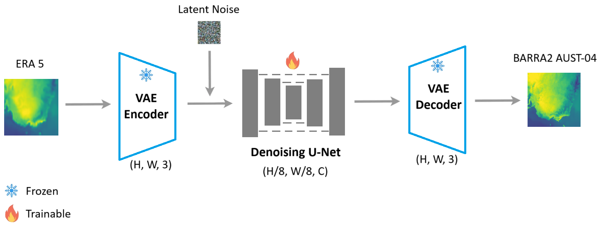

## BARRADiff Overview

* BARRADiff is a latent diffusion model built on top of [edm2](./README_edm2.md). The model was trained to downscale from ERA5 to BARRA2-C2. BARRADiff does not perform any forecasting but downscaling only. i.e. input and output have the same time step. Please refer to [PPT slides](./barradiff_docs/barradiff.pptx) for details.

* BARRADiff has 2 billion parameters trained with fp16 mixed-precision using 8 V100 GPUs on Gadi. We employed FSDP2 within a node and DDP between nodes.

* The training set has about 3 million training samples covering 12 single-level variables and pressure-level variables. Please refer to [training data](./data/training_data.py) for variable details.

## Environment Setup

* Edit the directory settings in `var_envs` to suit your environment

* Run `bash install_deps.sh` to set up the Python environment. This script also downloads the VAE encoder from huggingface into `$(pwd)/hf_cache`.

## Inference

Run `bash run_inference.sh` to inference the Australian region. The inference procedure works on a per variable per time step basis. One can edit the `var_time` and `barra2_var_names` in the script to target different times and variables.

Run `bash run_inference_global.sh` to inference the global region for the entire world.

## Training

* Please refer to [training set](./training_set.md) for details in file format and procedure for building training set.

* Run `bash run_trainer_gpu.sh` to start the training. Please refer to [training logs](./training_logs) for our own training run details.

